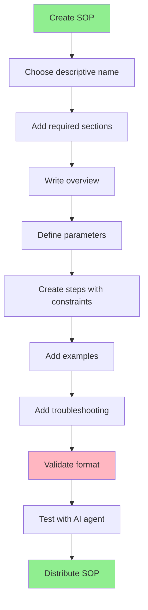

# Agent SOP Author

## Overview

Agent SOPs (Standard Operating Procedures) are markdown-based instruction sets that guide AI agents through sophisticated workflows using natural language, parameterized inputs, and constraint-based execution. This skill teaches you how to create (or update), structure, and validate Agent SOPs that work across different AI systems.

## Ontology

These are the concepts, categories, entities, terms, and relationships used in this skill:

- **Agent SOP**: A formal, discrete set of steps that forms a workflow an AI agent follows to accomplish a goal. SOP stands for Standard Operating Procedure, and an SOP is sometimes called simply a procedure. An SOP is defined by its structure and its writing, not by its location, so it can sit inside a skill or anywhere else. Each one holds an Overview, an Ontology, Parameters, and Steps, and may hold Examples and Troubleshooting.

- **Overview**: The opening section of an Agent SOP. It says what the SOP does and when to use it.

- **Ontology**: The section of an Agent SOP, directly after its Overview, that defines the terms, entities, categories, and relationships the SOP uses.

- **Parameter**: A named input an Agent SOP needs before its steps start. A parameter is either required or optional, and an optional one may have a default value.

- **Constraints for parameter acquisition**: The fixed list of constraints under the Parameters section that tells the agent how to collect any parameters it was not given.

- **Step**: One numbered stage of an Agent SOP. A step has a name, a description in natural language, and a Constraints list.

- **Constraint**: One requirement on how a step is carried out. Every constraint uses an RFC 2119 keyword.

- **RFC 2119 keyword**: One of MUST, MUST NOT, SHOULD, SHOULD NOT, and MAY, used with the meanings set by the RFC 2119 standard.

- **Negative constraint**: A constraint that prohibits or discourages something, using MUST NOT, SHOULD NOT, or NEVER. It always gives the reason for the prohibition.

- **Interactive SOP**: An Agent SOP with a step that asks the user questions and records the answers.

- **Validation script**: The `validate-sop.sh` file beside this skill, which checks an Agent SOP against the required structure. It checks a whole file, or only a range of lines in a file.

## Usage

When working with Agent SOPs and need to:
- Create new workflow automation SOPs
- Update existing workflow automation SOPs
- Structure multi-step agent workflows
- Apply RFC 2119 constraints (MUST, SHOULD, MAY)
- Validate SOP format and structure
- Convert workflows into reusable templates
- Ensure SOPs work across AI systems (Claude, Cursor, etc.)

## Core Concepts

### What is an Agent SOP?

An Agent SOP, sometimes called simply a procedure, is a formal, discrete set of steps that forms a workflow for accomplishing a goal. It is defined by its structure and its writing, not by where it is kept, so it can sit inside a skill or anywhere else. An Agent SOP defines:
- **Clear objectives** with detailed overviews
- **Parameterized inputs** for flexible reuse
- **Step-by-step instructions** with RFC 2119 constraints
- **Examples and troubleshooting** for reliable execution
- **Multi-modal distribution** (MCP tools, Agent Skills, Python modules)

### Key Features

**RFC 2119 Constraints**: Use standardized keywords (MUST, SHOULD, MAY) to provide precise control over agent behavior without rigid scripting.

**Parameterization**: Accept parameters that customize behavior for different projects, teams, or requirements.

**Resumability**: Document progress as agents work, making it easy to understand and resume if interrupted.

## Creating Agent SOPs

### Validation

**You MUST run validate-sop.sh after EVERY change:**

The validation script is located in the same directory as this SKILL.md file. When you read this skill, you will know the full path to SKILL.md, and the validation script is in that same directory.

```bash
<skill-directory>/validate-sop.sh path/to/the-file-that-holds-the-sop.md
```

When the SOP is one section of a larger file, add the SOP's first and last line numbers after the path, so that the script checks only those lines:

```bash
<skill-directory>/validate-sop.sh path/to/the-file-that-holds-the-sop.md 120 310
```

You **MUST** fix all errors (❌) before proceeding. You **SHOULD** address warnings (⚠️) when possible.

### Required Structure

Every Agent SOP **MUST** include these sections in order:

```markdown
# [SOP Name]

## Overview
[Concise description of what the SOP does and when to use it]

## Ontology

These are the concepts, categories, entities, terms, and relationships used in this procedure:

- **[Term]**: [Definition]

## Parameters

- **required_param** (required): Description
- **optional_param** (optional, default: "value"): Description

**Constraints for parameter acquisition:**
- If all required parameters are already provided, You MUST proceed to the Steps
- If any required parameters are missing, You MUST ask for them before proceeding
- When asking for parameters, You MUST request all parameters in a single prompt
- When asking for parameters, You MUST use the exact parameter names as defined

## Steps
### 1. [Step Name]
Description of what happens in this step.

**Constraints:**
- You MUST [specific requirement]
- You SHOULD [recommended behavior]
- You MAY [optional behavior]

## Examples
[Concrete usage examples]

## Troubleshooting
[Common issues and solutions]
```

### Ontology Section

You **MUST** give every Agent SOP an Ontology section directly after its Overview. You **MUST** load the `author-ontology` skill and write the section as it sets out.

You **MUST** define in it the terms, entities, categories, and relationships that the SOP's steps and constraints rely on, such as the kinds of subagent it starts, the passes it runs, and the files it writes.

### Parameters Section

You **MUST** define parameters using this format:

```markdown
## Parameters

- **parameter_name** (required): Description of required input
- **another_param** (required): Description
- **optional_param** (optional): Description of optional input
- **with_default** (optional, default: "default_value"): Description

**Constraints for parameter acquisition:**
- If all required parameters are already provided, You MUST proceed to the Steps
- If any required parameters are missing, You MUST ask for them before proceeding
- When asking for parameters, You MUST request all parameters in a single prompt
- When asking for parameters, You MUST use the exact parameter names as defined
```

**Parameter naming rules:**
- You **MUST** use lowercase letters
- You **MUST** use underscores for spaces (snake_case)
- You **MUST** be descriptive of purpose
- You **MUST** list required parameters before optional ones

**The Constraints for parameter acquisition section:**
- You **MUST** include this section in every Parameters section
- You **MUST** include these directives:
  - "If all required parameters are already provided, You MUST proceed to the Steps"
  - "If any required parameters are missing, You MUST ask for them before proceeding"
  - "When asking for parameters, You MUST request all parameters in a single prompt"
  - "When asking for parameters, You MUST use the exact parameter names as defined"
- You **MAY** add additional constraints for flexible input methods:

```markdown
**Constraints for parameter acquisition:**
- If all required parameters are already provided, You MUST proceed to the Steps
- If any required parameters are missing, You MUST ask for them before proceeding
- When asking for parameters, You MUST request all parameters in a single prompt
- When asking for parameters, You MUST use the exact parameter names as defined
- You MUST support multiple input methods including:
  - Direct input: Text provided directly
  - File path: Path to a local file
  - URL: Link to an internal resource
- You MUST use appropriate tools to access content
- You MUST confirm successful acquisition before proceeding
- You SHOULD save acquired data to a consistent location
```

### Steps Section

You **MUST** structure steps with:
1. Numbered heading (### 1., ### 2., etc.)
2. Step name
3. Natural language description
4. **Constraints:** section with RFC 2119 keywords

**Example:**

```markdown
### 1. Setup
Initialize the project environment and create necessary structures.

**Constraints:**
- You MUST validate directory structure exists
- You MUST create missing directories
- You MUST NOT proceed if directory creation fails
- You SHOULD log all setup actions
- You MAY skip validation if --force flag is provided
```

**For conditional logic:**

```markdown
### 3. Conditional Processing
If validation passes, proceed with processing. Otherwise, report errors.

**Constraints:**
- You MUST check validation status before proceeding
- If validation passes, You MUST process the data
- If validation fails, You MUST report specific errors
- You MUST NOT continue with invalid data
```

**For constraints that share a theme:**

When several constraints in one step fall under a common theme, You **SHOULD** group them in a sublist under a list item that names the theme.

```markdown
### 2. Run the Review
Start the reviewers and collect their findings.

**Constraints:**
- Every reviewer:
  - You MUST give each reviewer exactly one file
  - You MUST require each reviewer to write its findings to its own file
- The findings:
  - You MUST join the findings files into one file with a command line tool
  - You MUST NOT retype the findings because retyping can drop or change an entry
```

**For progress tracking:**

You **MUST** open the Steps section with a progress checklist that the agent copies and checks off as it finishes each step.

**For long steps:**

You **SHOULD** split a step into several steps when its constraints grow long or their order matters, because the order of an SOP comes from its numbered steps and the constraints within a step have no order.

### RFC 2119 Keywords

You **MUST** use these keywords as defined in RFC 2119:

- **MUST** / **REQUIRED**: Absolute requirement
- **MUST NOT** / **SHALL NOT**: Absolute prohibition
- **SHOULD** / **RECOMMENDED**: Strong recommendation (may have valid reasons to ignore)
- **SHOULD NOT** / **NOT RECOMMENDED**: Strong discouragement (may have valid reasons to accept)
- **MAY** / **OPTIONAL**: Truly optional item

### Negative Constraints

You **MUST** provide context when using negative constraints:

**Good (with context):**
```markdown
- You MUST NOT use ellipses (...) because your output will be read aloud by text-to-speech
- You SHOULD NEVER delete Git history files since this could corrupt the repository
- You MUST NOT run `git push` because this could publish unreviewed code
```

**Bad (without context):**
```markdown
- You MUST NOT use ellipses
- You SHOULD NEVER delete Git files
- You MUST NOT run git push
```

**Common contexts for negative constraints:**
- Technical limitations: "because the system cannot handle..."
- Security risks: "since this could expose sensitive data..."
- Data integrity: "as this could corrupt important information..."
- User experience: "because users will be confused by..."
- Compatibility: "since this breaks integration with..."
- Performance: "as this could cause significant slowdowns..."

### Examples Section

You **SHOULD** include concrete examples showing:
- Example input parameters
- Expected output or behavior
- Common usage patterns

```markdown
## Examples

### Example 1: Basic Usage
**Input:**
- task_description: "Create user authentication system"
- mode: "interactive"

**Expected Behavior:**
Agent will guide through TDD workflow, creating tests first, then implementation.

### Example 2: Automated Mode
**Input:**
- task_description: "Fix bug in payment processing"
- mode: "auto"

**Expected Behavior:**
Agent will automatically implement fix following established patterns.
```

### Troubleshooting Section

You **SHOULD** include common issues and solutions:

```markdown
## Troubleshooting

### Parameter Validation Fails
If parameter validation fails, check that:
- All required parameters are provided
- Parameter names use snake_case
- Values match expected types

### Step Execution Hangs
If a step appears to hang:
- Check for missing tool permissions
- Verify file paths are accessible
- Review constraint requirements
```

## Interactive SOPs

For SOPs requiring user interaction:

1. You **SHOULD** clearly indicate when user interaction is expected
2. You **MUST** specify how to handle user responses
3. You **SHOULD** specify where to save interaction records

**Example:**

```markdown
### 2. Requirements Clarification
Guide the user through questions to refine their initial idea.

**Constraints:**
- You MUST ask one question at a time
- You MUST append each Q&A to "idea-honing.md"
- You SHOULD adapt follow-up questions based on previous answers
- You MUST continue until sufficient detail is gathered
```

## Best Practices

You **SHOULD** follow these practices when authoring SOPs:

1. **Keep steps focused**: Each step should accomplish one clear objective
2. **Use clear constraints**: Be specific about requirements vs recommendations
3. **Provide examples**: Show concrete usage for complex workflows
4. **Natural language**: Write descriptions that are easy to understand
5. **Minimize complexity**: Avoid deeply nested conditional logic
6. **Specify artifacts**: Include file paths for all created artifacts
7. **Test thoroughly**: Validate SOPs work across different AI systems
8. **Document edge cases**: Include troubleshooting for common issues

## Quick Reference

| Element | Format | Required |
|---------|--------|----------|
| Title | `# SOP Name` | Yes |
| Overview | `## Overview` | Yes |
| Ontology | `## Ontology` | Yes |
| Parameters | `## Parameters` | Yes |
| Steps | `## Steps` with `### N.` | Yes |
| Constraints | `**Constraints:**` with RFC 2119 | Yes |
| Examples | `## Examples` | Recommended |
| Troubleshooting | `## Troubleshooting` | Recommended |

## Common Patterns

### Before: Unstructured Prompt
```markdown
Please implement a user authentication system using TDD.
Make sure to write tests first and follow best practices.
```

### After: Structured SOP
```markdown
# Code Assist

## Overview
This SOP guides implementation using test-driven development.

## Parameters
- **task_description** (required): Description of task
- **mode** (optional, default: "interactive"): "interactive" or "auto"

## Steps
### 1. Setup
Initialize project environment.

**Constraints:**
- You MUST validate directory structure
- You MUST create test directory if missing
- You MUST NOT proceed if setup fails

### 2. Test Creation
Create tests based on requirements.

**Constraints:**
- You MUST write tests before implementation
- You SHOULD follow existing test patterns
- You MAY add additional edge case tests
```

## Common Mistakes

### Missing Context in Negative Constraints
**Problem:** Using MUST NOT without explaining why.
**Fix:** Always provide context: "You MUST NOT X because Y"

### Vague Parameter Descriptions
**Problem:** "input_data (required): The data"
**Fix:** "input_data (required): JSON object containing user profile fields (name, email, role)"

### Mixing Requirement Levels
**Problem:** Using MUST for optional behaviors or MAY for critical requirements.
**Fix:** Use RFC 2119 keywords precisely - MUST for absolute requirements, SHOULD for recommendations, MAY for optional.

### Missing Examples
**Problem:** Complex workflow without concrete usage examples.
**Fix:** Include at least one complete example showing input parameters and expected behavior.

### Overly Complex Steps
**Problem:** Single step trying to accomplish multiple objectives with nested conditionals.
**Fix:** Break into multiple focused steps, each with clear constraints.

## Visual Workflow



## The Bottom Line

Agent SOPs transform complex workflows into reusable, shareable instructions that work across different AI systems. They use standardized markdown format with RFC 2119 constraints to provide precise control while preserving agent reasoning ability.

When creating SOPs, focus on clear structure, specific constraints with context, and concrete examples. Test thoroughly across different AI systems to ensure reliability.
